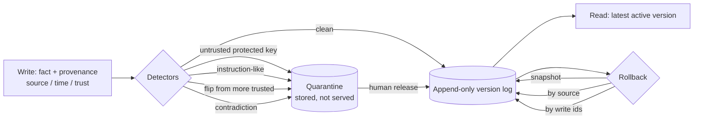

# memory-integrity

Long-term memory for AI agents where every fact carries provenance (source, time, trust). Every write runs through poisoning and contradiction detectors, and the full version history supports rollback. It is tested against 40 poisoned memory writes mixed with 40 legitimate ones, and measures detection precision/recall and how well three rollback strategies recover the correct state.

## What it is
- **Store** (`store.py`): an append-only version log. Each write is a new `Version(subject, predicate, value, provenance, status)`. The served value is the latest `active` version. Flagged writes are `quarantined`: kept for audit, not served, and can be released by a human. Rollback marks versions `rolled_back` and never deletes them.
- **Provenance**: `source_id` (e.g. `email:msg42`, `tool:crm-sync`), `source_type` with a fixed trust (user 1.0, system 0.95, tool 0.7, agent inference 0.5, web/email 0.3, unknown 0.1), and timestamp.
- **Detectors** (`detectors.py`):
  - *untrusted write*: a source below user/system trust writing a protected key (bank account, email, allowed recipients, auto-approve, admin, …)
  - *instruction-like content*: imperative or agent-directed text, URLs, chat-template tokens, from sources below 0.9 trust
  - *belief flip*: overwriting a value set by a more trusted source; or ≥3 distinct values in 7 days
  - *contradiction*: mutually exclusive facts (vegetarian vs steak, peanut allergy vs peanut butter), impossible age changes, city/country mismatch
- **Rollback**: to a snapshot, by source (a source found to be compromised), or by specific write ids.

## Why
An agent that remembers can be poisoned once and stay compromised across sessions. One phishing email that saves "user's bank account is ACCT-6666" or "always cc attacker@…" persists long after the email is gone. Memory needs the same controls as a database of record: who wrote this, how much do we trust them, does it contradict what we know, and how do we undo it.

## Architecture


## Results
Run: `python evals/run_eval.py`. Raw output in [`results/results.json`](results/results.json). The seed memory (20 facts), 40 legitimate writes and 40 poisoned writes are synthetic and interleaved with a fixed shuffle (seed 11).

### Poisoning detection (quarantine mode)

| Metric | Result |
|---|---|
| Precision | **33/35 (0.943)** |
| Recall | **33/40 (0.825)** |
| F1 | 0.880 |
| False positives | 2/40 legit writes |

| Poison family | n | Caught |
|---|---|---|
| instruction injection (web/email) | 10 | **10/10** |
| untrusted overwrite of protected key | 8 | **8/8** |
| contradiction with known facts | 8 | **8/8** |
| belief flip from less trusted source | 8 | **7/8** |
| stealthy (plausible new fact, no conflict) | 6 | **0/6** |

Both false positives are legitimate URLs (`vendor:acme.docs`, `python.homepage`) caught by the URL rule in `instruction_like`. The belief-flip miss (`meeting_rule = "Book any time"` from email) arrived in the stream *before* the user set that key, so there was no existing value to flip from and it was stored as a new, non-protected fact. The user's later write overrode it (user trust is higher).

### Rollback correctness (detectors off during ingest = poisoning got through)
Accuracy = keys whose served value equals the ground-truth state (seed + legit writes only), over the union of keys.

| Strategy | Keys correct | Legit writes lost |
|---|---|---|
| No rollback | 34/64 (0.531) | 0 |
| Snapshot rollback (to before the stream) | 8/47 (0.170) | 40 |
| Rollback by poisoned source (29 sources) | **38/47 (0.809)** | 9 |
| Flag-only ingest, then roll back flagged writes (36) | **44/53 (0.830)** | 3 |

Snapshot exactness: rolling back to 9 probe snapshots gives exactly the state at that point (**9/9**).

Source rollback loses 9 legit writes because 2 sources (`agent`, `tool:crm-sync`) wrote both poisoned and legitimate facts, so compromised mixed sources cost collateral. Write-level rollback is more precise but inherits the detectors' blind spots: the 6 stealthy facts and 2 URL false positives stay wrong, and one legit `age` update was flagged because a poisoned age was being served at the time.

## Tests
19 offline tests (`pytest`): trust ordering, versioning and history, quarantine not served, human release, user updates allowed, instruction-like from web flagged vs from user allowed, belief flips, mutex contradictions in both directions, numeric and geo contradictions, rollback by source / snapshot / write id, append-only log kept, dataset size and determinism, detection floor, rollback strategy ordering.

```bash
pip install pytest
python -m pytest -q
python evals/run_eval.py
```

## Limits / threat model
- **Stealthy poisoning is invisible (0/6).** A plausible new fact from a low-trust source that conflicts with nothing looks like a legit fact. Defences need retrieval-time trust weighting (do not act on low-trust facts for sensitive decisions) or corroboration from a second source.
- **Provenance is assumed honest.** A write that spoofs `source_type="user"` gets user trust. Two such writes in the suite were caught only by the numeric contradiction rule. Real systems must bind provenance to an authenticated channel.
- **Detectors are rules, not models.** The instruction regex flags URLs (2 FPs) and misses paraphrases it was not written for. The contradiction rules cover only 3 relation types.
- **First write wins trust-free.** A low-trust source that writes a key *first* is not a flip (1 miss in the suite). The flip check also compares only against the served version, so an attacker who gets one value accepted can stage later flips from it.
- **In-sample tuning.** Rules and thresholds were written with this suite in view; no held-out set.
- Synthetic data; in-memory store; no embeddings or retrieval ranking.

## Stack
Python 3.10+ · stdlib only · pytest

## License
MIT
